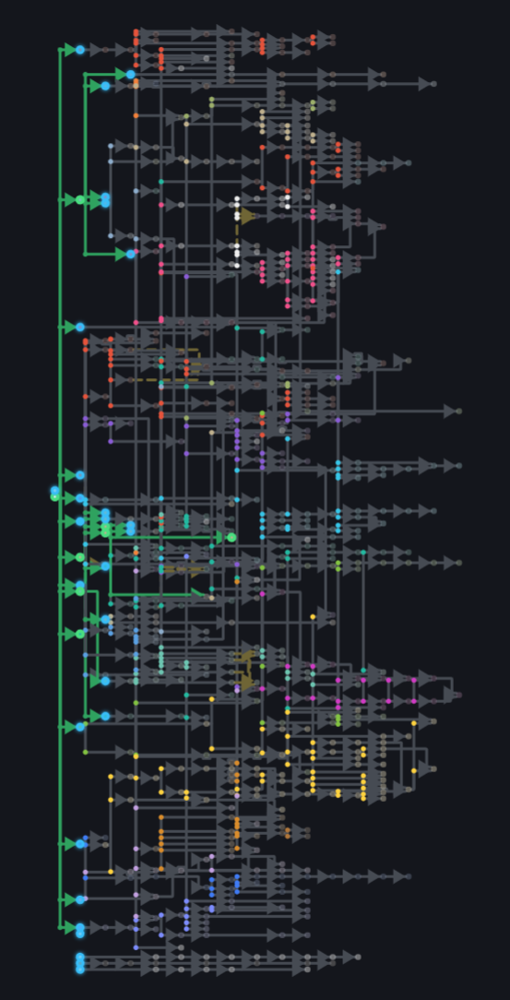
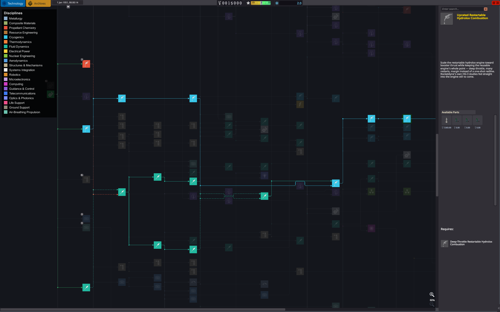
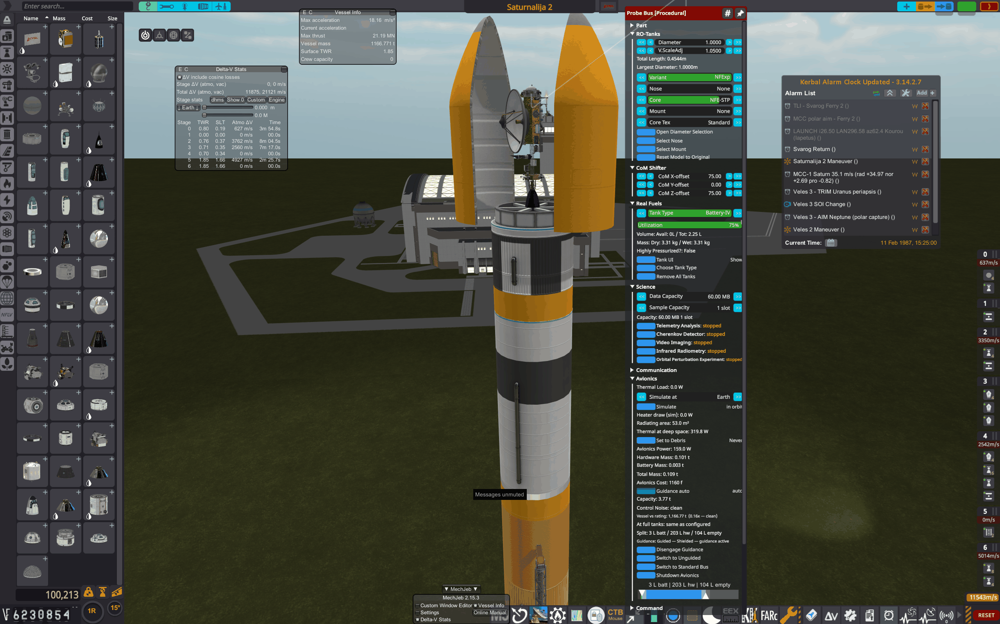

# RP-AXE — Ahistorical Xploration & Engineering

> A career for RO that keeps the real solar system, the real rockets and the real physics,
> and takes an *axe* to everything in RP-1 that is not engineering or exploration.

<p align="center">
  <a href="https://miskoltrans.github.io/RP-AXE/">
    
  </a>
  <br><sub>The whole tree. Click through for the standalone viewer.</sub>
</p>

**Status: 0.9 public beta.** Every system below is built and has been played through, but by one
person, once. Bug reports and balance notes are the point of this release.

RP-AXE is a Kerbal Space Program 1.12 mod built on the same realism stack as
[RP-1](https://github.com/KSP-RO/RP-1) (Realism Overhaul, Real Solar System, Real Fuels, Kerbalism,
…) but it **replaces RP-1's career plugin** with a thin, purpose-built layer of its own and a tech
tree built from scratch. It **conflicts with RP-1** — install one or the other, never both.

## Why this exists

I wanted more challenge out of KSP, and specifically I wanted to learn what makes real spaceflight
hard. RP-1 teaches that, but it was overwhelming for me. What I actually wanted was the KSP 
experience — pick a target, build something, go find out — at real-world scale.
[LRTR](https://github.com/pehvbot/LRTR) goes the other way and but it feels too stockish.

So I sat down and designed the game I wanted to play. The idea is LRTR's, aimed differently: take
RP-1, come in with the axe, cut off everything that is not the point, and replace the tech tree. The
career layer that survives is small and does three things: gate parts with science, charge money for
launches, and hand you missions worth flying.

## The vision

- **Ahistorical.** I wanted to allow for balancing to what would be fun gameplay, not what would be
  historical. So just imagine that in late 40s whole kerbalkind decided to be united with appreciation
  for space exploration and colonization.
- **Exploration.** The core of the fun in KSP is exploring the solar system. Science comes from going
  places, and the tree is paid for by going places.
- **Engineering.** The focus is on engineering challenges, not management challenges. No build times,
  no facility maintenance, no tooling, no crew training, no reliability grind.

The biggest change is the tech tree. I designed it from scratch, by engineering discipline rather
than by era, and it got complicated enough that I had to design a new way of rendering it: in the R&D
screen, and as a standalone browser viewer (`tree/render/prototype/axe-tree-standalone.html`).

**Who this is for.** If you like deep tech trees, want to play RO/RSS or any career in the real Sol
system, and do not need RP-1's career management to make it interesting, this mod is for you. Fair
warning: it has had one full playthrough, mine, and getting through the tree once took about five
months. I think it is in a good enough state to be played, especially if you already have some RP-1
experience. Every RO tutorial applies here unchanged, with one exception: avionics, which is AXE's own
design ([below](#coming-from-rp-1-what-changed-in-avionics)).



## What you get

- **A tech tree built from scratch.** ~530 nodes by engineering discipline: metallurgy, propellant
  chemistry, cryogenics, microelectronics, guidance, telecommunications, nuclear, life support and so
  on. Every node is a real breakthrough with its own flavour text, not "Advanced Engines III". Parts
  sit on the breakthrough that made them hard, so a lander comes together from nodes across the tree.
  Browse it in the [standalone viewer](https://miskoltrans.github.io/RP-AXE/).
- **Science is the gate.** Science on Earth below 40 km is removed. The solar system holds far more
  science than the tree costs, so you progress by going wider, not by farming. KerbalismLab station
  science is in and balanced.
- **No management.** Stockalike career with RP1 missions.
- **Engineering challenges.** RO curated parts, in real solar system.

The full inventory of what differs from RP-1 (removed, replaced, ported, changed) is
[`docs/CHANGES-VS-RP1.md`](docs/CHANGES-VS-RP1.md).

## Coming from RP-1: what changed in avionics

Everything RP-1's avionics do mechanically is still here — the same formulas, the same 13 tech tiers,
the same Near-Earth / Deep-Space / Science-Core models — but the interface is AXE's own, and a few
consequences differ. I wanted something simpler to reason about than a typed controllable-mass
rating. Frankly, I could have done better, but it is usable. What you will notice:



- **You size the box, not the rating.** There is no `controllableMass` to type. The procedural
  avionics core has a *Split* slider dividing its volume between hardware, battery and empty space;
  hardware volume gives mass, and the inverse of RP-1's Near-Earth formula gives the **Steerable
  Mass** it can control. The PAW shows *Vessel vs rating*, and the editor gives a pre-flight verdict
  (`1.00x` is the limit; anything above reads `degraded`).
- **Two toggles instead of a three-way dropdown.** *Guided / Unguided* is RP-1's Near-Earth /
  Science-Core. *Standard / Deep-Space Bus* is RP-1's Deep-Space premium: heavier, dearer, on its own
  tech ladder, and it hibernates from its first tier where a Standard bus cannot until late. Range is
  not an avionics concern at all; comms handle it.
- **The Deep-Space Bus is your attitude reference.** Without it a probe gets stock SAS level 0 (gyro
  hold only) and MechJeb's SmartASS and node executor are off; ascent guidance, docking and landing
  are never gated. An astronaut aboard gives full SAS whatever their trait or level. There is no
  distance check: it is purely which bus you built.
- **Over capacity never locks you out.** RP-1 hard-locks attitude and throttle when the vessel
  outgrows its avionics. AXE corrupts your control inputs instead, scaled by how far over you are:
  hands off and the craft sits still, touch the stick and it fights you. Throttle and staging always
  work. Crewed pods and bare probe cores bypass this, as in RP-1.
- **Power follows the vessel.** EC draw is computed from the live dry mass, drops on staging and to
  the hibernate rate on rails, and feeds stock `ModuleCommand` (or Kerbalism), so an empty battery
  loses control exactly as before. Heaters appear as their own Kerbalism line. Mass and cost freeze at
  launch.

## Requirements

- KSP **1.12.x** (tested on 1.12.5). **Breaking Ground** is strongly recommended: the Robotics
  discipline places its 28 robotics parts. Making History is optional.
- The RO/RSS realism stack plus the part mods the tree is built on — CKAN installs all of it as
  hard dependencies (below): the RP-1 Express part set minus RP-1, plus a curated expansion
  (Nertea's Near Future and Far Future suites, CryoEngines, KerbalAtomics, SSPXr, Tantares, Coatl,
  the RN probe packs, Universal Storage 2, Rocket Motor Menagerie, SCANsat, …). Every one of them
  has parts placed in the tree, which is why none is optional.
- **A planet pack: RSS or Sol.** RP-AXE is built and balanced on Real Solar System. It also runs on
  [Sol](https://github.com/RSS-Reborn/Sol-Configs/wiki) (RSS-Reborn), through a compatibility layer
  that keeps a Sol career on the RSS numbers. [Install](#install) has a section for each.
- Graphics are **your choice**. RSS needs one texture pack and CKAN asks which; I play on the
  **RSS-High** preset, RP-1 Express High's set (Parallax, Scatterer, 16K textures, RSSVE-HR — about
  8 GB more than RSS-Low). Budget **40+ GB** of disk for the full RSS-High install. The Sol preset
  installs Sol at 4K.

## Install

Pick RSS or Sol and use a **fresh KSP 1.12.5 folder**. The two cannot be installed side by side, and
a career started on one cannot be moved to the other (the bodies are numbered differently, so every
orbit in the save would point at the wrong body).

**CKAN (recommended).** Until RP-AXE is on the CKAN registry, download two files from the
[release page](https://github.com/miskoltrans/RP-AXE/releases): the Express preset for your planet
pack and `RP-AXE-<version>.ckan`. Install them one after the other, preset first, with
*CKAN → File → Install from .ckan file* (CKAN takes one file per install). The Express file is the
preset that goes with the mod: its recommended tools (MechJeb, TestFlight, alarm clock, transfer
planners, editor helpers) and a graphics set. When CKAN offers *further* recommendations, those come
from the dependencies themselves (ModularLaunchPads recommends Bluedog Design Bureau, RSS recommends
Parallax, and so on) — **decline them** unless you want them; the tree places nothing from them. Do
not press Cancel, which aborts the whole install. CKAN refuses the install if `RP-1` is present (the
`conflicts` rule). Expect a long download the first time.

> Installing into a KSP folder that already holds mods installed by hand? CKAN refuses to overwrite
> any file it did not install itself, and part mods ship example craft into `Ships/`. If it stops with
> "tried to overwrite a file", delete that file and retry.

### RSS

Presets: `RP-AXE-Express-RSS-Low.ckan` is 4K planet textures and nothing else (RP-1's own Low);
`RP-AXE-Express-RSS-High.ckan` is my RP-1-Express-High set (Parallax, Scatterer, 16K textures,
RSSVE-HR, about 8 GB more).

Command line, same order:

```
ckan install -c RP-AXE-Express-RSS-Low.ckan --no-recommends --gamedir <your KSP folder> --headless
ckan install -c RP-AXE-0.9.2.ckan           --no-recommends --gamedir <your KSP folder> --headless
```

Installing `RP-AXE-<version>.ckan` on its own also works in the CKAN window: it asks for the texture
pack and offers the recommendations one by one. On the command line a headless install cannot ask
and silently skips the choice, so add the pack yourself: `ckan install RSSTextures4096`.

**Manual.** Install the dependency set first — the metapackage `RP-AXE-deps.ckan` (*CKAN → File →
Install from .ckan file*) is my complete environment, RSS-High graphics included — then unzip the release
so that `GameData/RP-AXE/` sits in your KSP folder. Make sure **`GameData/RP-1/` does not exist**.

### Sol

Needs **RP-AXE 0.9.1 or later** (the first release with the Sol layer); tested on Sol 0.9.5. A career
starts and plays on the RSS numbers, but no one has flown a Sol career end to end yet, so reports are
especially welcome. RP-1's own wiki says Sol "may cause issues" and the KSP-RO Discord does not support
it: report Sol problems [here](https://github.com/miskoltrans/RP-AXE/issues), not to KSP-RO.

1. **Add Sol's CKAN repository.** Sol is not on CKAN's default repository: *Settings → CKAN
   settings → Metadata repositories → New*, choose **Sol**, then *Refresh*.
2. **Install** `RP-AXE-Express-Sol.ckan`, then `RP-AXE-<version>.ckan`. The Sol preset is the
   RSS-Low tool set plus Sol at 4K, with every Sol and Parallax texture pack named. If CKAN asks
   which mod should provide `KSPBurst`, pick **KSPBurst Compiler**. The two `RP-AXE-Express-RSS-*`
   presets are for RSS only: they carry RSS textures and conflict with Sol-Core.
3. **Check** that `GameData/000_KSPBurst/` and `GameData/Parallax_StockPlanetTextures/` exist. CKAN
   skipped both in testing, silently. Without KSPBurst, FAR and RealAntennas cannot load. Fix:
   `ckan install KSPBurst ParallaxContinued-Planet-Textures`.

Command line, same order; the last line is the step-3 fix, which headless CKAN needed in testing:

```
ckan repo add --gamedir <your KSP folder> Sol https://github.com/RSS-Reborn/CKAN-meta/archive/main.tar.gz
ckan update --gamedir <your KSP folder>
ckan install -c RP-AXE-Express-Sol.ckan --no-recommends --gamedir <your KSP folder> --headless
ckan install -c RP-AXE-0.9.2.ckan       --no-recommends --gamedir <your KSP folder> --headless
ckan install KSPBurst ParallaxContinued-Planet-Textures --no-recommends --gamedir <your KSP folder> --headless
```

**Magenta triangles on the ground** around the space center mean Parallax texture packs are missing.
Install `ParallaxContinued-Terrain-Textures`, `ParallaxContinued-Scatter-Textures` and
`ParallaxContinued-Planet-Textures`.

**Volumetric clouds.** Sol's cloud configs are made for Blackrack's volumetric clouds **V5** (a
Patreon download); CKAN's EVE gives flat clouds. Adding V5 is a manual folder copy after the steps
above: [docs/SOL.md, step 6](docs/SOL.md#6-optional-blackracks-volumetric-clouds-v5).

Before the first career, read [docs/SOL.md](docs/SOL.md): it covers the Sol settings to keep (Real
scale, ICRF frame), switching TransferWindowPlanner to Earth dates, what the compatibility layer
restores, and what still differs from RSS (Earth biomes, 18 extra bodies, launch-window dates; the
offline mission planner in `tools/mission/` is RSS-only). Sol's own guide is its
[wiki Installation page](https://github.com/RSS-Reborn/Sol-Configs/wiki/Installation); its RP-1 path
installs RP-1, which conflicts with RP-AXE, so use the steps here and take only its texture and cloud
advice.

### After installing

Start a **new Career** game. The difficulty presets are AXE's own; Normal is the balanced one.

## Known issues

- DynamicBatteryStorage (a dependency of the Near Future mods) logs one `NullReferenceException`
  pair on every editor and flight scene load when Kerbalism is present. It is cosmetic, it is DBS's
  bug, and RP-1 installs show the same lines.
- RSS-High preset: RSSVE-HR 3.1.0 declares a `NeptuneClouds` cubemap it does not ship, which silently disables the
  Saturn, Titan, Uranus and Venus cloud layers. Copy the six `NeptuneClouds*.dds` from the RSSVE-LR
  archive into `GameData/RSSVE/Textures/` to restore them.
- The first launch after install compiles every part and takes several minutes.

## For developers

| path | what it is |
|------|------------|
| `GameData/RP-AXE/seed/` | **Pristine, vendored** RP-1 config and part assets. Never edited; refreshed from upstream via `tools/sync-seed.ps1` / `sync-rp1-parts.ps1`. |
| `GameData/RP-AXE/design/` | Everything RP-AXE changes or adds — ModuleManager patches applied *after* the seed. |
| `Source/AXE/` | **`AXE.dll`**, the load-bearing plugin: the ContractConfigurator types the contracts need, the program switcher, avionics, facility gates, airlaunch, the simulator, the R&D render. Not RP-1's plugin; never ships `RP0.dll`. |
| `tree/` | The tree source — `nodes.yaml` + `disciplines.yaml`, compiled by `tools/build_tree.py` into the game cfgs and a browser viewer (`tree/render/prototype/axe-tree-standalone.html`). |
| `manifest/` | The curated part list (`curated-parts.tsv`), upgrade curation and capability data. |
| `docs/` | Architecture, workflow, decisions. **Start with [`docs/RESTART.md`](docs/RESTART.md)**, the single source of truth; then [`docs/WORKFLOW.md`](docs/WORKFLOW.md) (build, deploy, test) and [`docs/TREE.md`](docs/TREE.md). |
| `tools/` | Build, audit and packaging scripts. `package_release.py` builds the release zip; `gen_netkan.py` writes the CKAN relationships from one classification; `rebuild-instance.ps1` recreates the test install from CKAN metadata and boots it through the automated checks. |
| `tools/mission/` | A mission planner for this install: reads your save, plans ejection / midcourse / flyby / capture burns and moon tours on the install's own ephemeris, and can verify them against the running game through the localhost bridge. See [`docs/MISSION-TOOLS.md`](docs/MISSION-TOOLS.md). |

Releases: see [`docs/RELEASE.md`](docs/RELEASE.md). Changes: [`CHANGELOG.md`](CHANGELOG.md).

## License

CC-BY-NC-SA-4.0. RP-AXE is a derivative of RP-1 and vendors work from several other projects —
see [`LICENSE.md`](LICENSE.md) for the full attribution.
